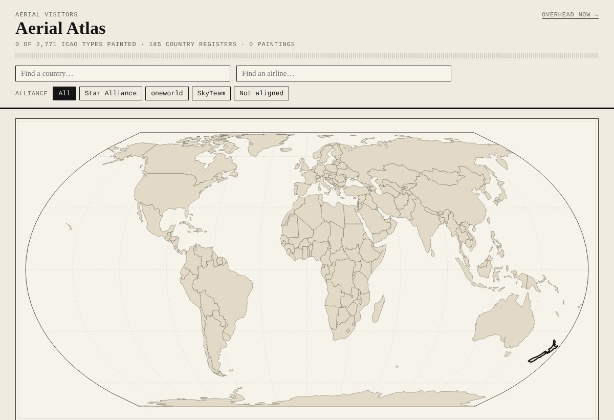
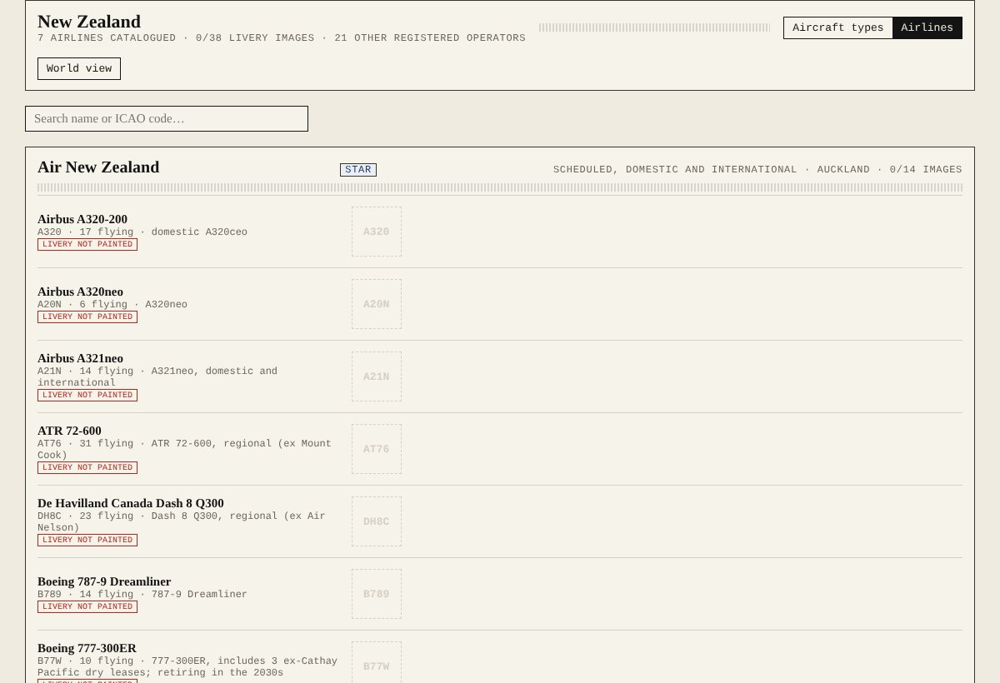

# Aerial Visitors

Woodblock-style illustrations of aircraft and airline liveries, built the same way as
[Avian Visitors — New Zealand](https://github.com/tandarra/avianvisitors-NewZealand), but for planes: a master painting of
every aircraft type, then each airline's real livery on top, catalogued by country and alliance in one repository.
The style follows the [Avian Visitors](https://theodore.net/projects/AvianVisitors/) guidelines by Teddy Warner:
very few marks, flat colour zones, sumi-e ink linework, cream mulberry-paper ground.

<table>
<tr>
<td width="50%"><a href="https://tandarra.github.io/AerialVisitors/atlas.html"></a></td>
<td width="50%"><a href="https://tandarra.github.io/AerialVisitors/atlas.html#NZ"></a></td>
</tr>
<tr>
<td align="center"><sub><b>Aerial Atlas</b>: 2,771 ICAO aircraft types, 185 country registers, alliance filter</sub></td>
<td align="center"><sub><b>Airlines</b>: every fleet with its liveries, side profile and from below</sub></td>
</tr>
</table>

**Aerial Atlas:** [`atlas.html`](https://tandarra.github.io/AerialVisitors/atlas.html) — a world map where each country is
shaded by how much of its checklist is painted; click it to open the checklist. Find a country, find an airline, or filter
by alliance (Star Alliance, oneworld, SkyTeam).

**Overhead Now:** [`index.html`](index.html) — what is in the sky over your station right now, each aircraft shown in its
airline's livery when there is one, else the master painting of its type (needs the Cloudflare deployment for live data).

**Airlines by country:** [`AIRLINES.md`](AIRLINES.md) — every airline catalogued so far, by country and by alliance, with
livery progress.

**Illustration checklist:** [`planes/master_index_NZ.csv`](planes/master_index_NZ.csv) — every aircraft type on the New
Zealand register, with what has been painted so far (the atlas shows the same as a checklist).

## How it fits together

1. **Masters.** One plain, anatomy-checked master airframe per aircraft type (`planes/<type>.webp`), painted in two poses.
2. **Liveries.** For every airline that flies the type, the master is repainted in the airline's real colours, name and
   logo (`planes/liveries/<country>/<airline>/<type>.webp`). Until a livery exists the atlas and the live page show the master.
3. **Catalogue.** `planes/catalogue.json` ties airlines to fleets and liveries; `liveries/alliances.json` ties airlines to alliances.
4. **Countries.** Start with one country (New Zealand), then add the next fleet file. Everything ends up in this one repo.

## What's in here

| Path | What it is |
|---|---|
| `planes/raw/` | Paintings as generated (not committed: the pipeline keeps the originals in `Downloads\AerialVisitors`) |
| `planes/<type>.webp` | **Master airframe**, side profile, background removed (slug = ICAO type code, lower case) |
| `planes/<type>-2.webp` | Second pose: from below, climbing |
| `planes/liveries/<country>/<airline>/<type>.webp` | An airline's livery on a type, e.g. `liveries/new-zealand/air-new-zealand/a320.webp` (`-2` = from below) |
| `planes/catalogue.json` | Airlines by country: ICAO codes, fleets, which livery images and masters exist. Built by `tools/catalogue.py` |
| `planes/master_list_NZ.json` | Frozen copy of the New Zealand register's type list: the target for the master index |
| `planes/index.json` | Aircraft types painted so far (ICAO code → name) |
| `planes/master_index_NZ.csv`, `planes/progress_NZ.json` | Progress checklist and compact checklist data, regenerated by `--progress` |
| `planes/painted.json` | Cut-out masters per type, written by the generator |
| `planes/types.json`, `planes/operators.json`, `planes/world.json` | ICAO types, ICAO airlines (name, country, callsign) and every country's register. Rebuilt daily on GitHub by `tools/build_reference.py` |
| `planes/world-110m.json`, `vendor/`, `atlas.html` | World map front page (d3-geo + Natural Earth 110m) with the type and airline checklists |
| `liveries/nz.json` | New Zealand's airlines and the types they fly (with sources); one file per country |
| `liveries/alliances.json` | Star Alliance, oneworld and SkyTeam members by ICAO airline code |
| `liveries/nz_airframes.json` | Hand-written anatomy for each master (engines, blades, wings, tail, gear, length and span) |
| `AIRLINES.md` | Airlines by country and alliance with livery progress (built by `tools/build_airlines_md.py`) |
| `plane_illustrations.py` | Generator: paints types with Gemini, cuts out the background, builds progress lists |
| `tools/aerial_run.py` | **The one command**: masters, then liveries, then cut-out, catalogue and `git push` |
| `tools/build_airframe_prompts.py`, `tools/build_livery_prompts.py` | The prompts as copy-paste packs for the Gemini app, with checklists (`liveries/NZ-airframes_checklist.html`, `liveries/NZ_checklist.html`) |
| `tools/build_collage.py`, `tools/screenshots.py` | Regenerate `docs/images/` for this README |
| `tools/log_sightings.py` | Logs aircraft near home into a life list; writes `planes/seen.json` for the site |
| `index.html`, `functions/api/overhead.js`, `lib/adsb.js` | The live page and its API (adsb.lol, cached 8 s) |
| `worker.js`, `wrangler.jsonc` | The same site as a Cloudflare Worker instead of Pages |
| `docs/images/` | Screenshots used in this README |
| `.github/workflows/update-reference.yml` | Refreshes the reference data daily |

Not committed (see `.gitignore`): API keys, reference photos in `planes/refs/`, raw paintings and your private sightings log.

## Style rules

Prompt template adapted from Avian Visitors:

- Edo-period Japanese woodblock print, **very few marks**: 2–4 flat colour zones, no rivets, panel lines or single windows
- Confident sumi-e ink linework, soft watercolour washes
- Earthy palette: burnt umber, ochre, indigo, vermillion, muted greens
- Identical warm cream mulberry-paper ground; **no sky, runway or scenery**
- Correct anatomy: the exact number of engines, propeller blades, wings and fins, the real wing position and the real
  proportions (each master has a written spec and a "check" line)
- Two poses per aircraft: **side profile** (nose right) and **from below, climbing** as it passes overhead
- Masters are plain white and grey with one indigo stripe, no text. Liveries add the airline's real colours, name and logo
  where the real aircraft carries them, and never registration marks

Model: Gemini **Nano Banana 2.1** (`gemini-nano-banana-2.1`). Liveries are repainted from the approved master so the shape never drifts.

## Workflow

Requires Python 3 with `pip install -r requirements.txt` (`requests`, `pillow`, `rembg[cpu]`).
Put your key in `plane_keys.txt` next to the script (ignored by git):

```
GEMINI_API_KEY=...
```

```powershell
# See what's left and what it will cost
python tools\aerial_run.py --list-only

# Masters first, so you can look at them in the atlas before painting liveries
python tools\aerial_run.py --stage masters

# Everything for New Zealand: masters, liveries, cut-out, catalogue, commit and push (72 images, about US$2.50)
python tools\aerial_run.py

# Another country: write liveries\<cc>.json like liveries\nz.json, then
python tools\aerial_run.py --fleet liveries/<cc>.json

# Run it hidden in the background and watch the log
Start-Process python -ArgumentList 'tools\aerial_run.py' -WindowStyle Hidden
Get-Content "$HOME\Downloads\AerialVisitors\run.log" -Wait

# Images made by hand (Gemini app)? Copy the prompts from the checklists, save as planes\raw\<type>.png / <type>-2.png, then
python plane_illustrations.py --cutout-only

# Rebuild a country's progress checklist
python plane_illustrations.py --progress --country NZ
```

The run saves originals to `C:\Users\Kurt\Downloads\AerialVisitors\` (`_masters\` and `<Country>\<Airline>\`) with a `run.log`,
commits and pushes every 10 images, and can be stopped and re-run at any time: finished images are skipped.

## Overhead Now

`index.html` polls adsb.lol for aircraft within 25 nm of the home position in `wrangler.jsonc` and shows each one. It runs
as a Cloudflare Worker or Pages Function (`functions/api/overhead.js`); on a static host it says the live feed is unavailable.

```powershell
python tools\log_sightings.py --loop 30     # keep a life list of what flies over; writes planes\seen.json
python plane_illustrations.py --sightings   # paint exactly the types you have seen
```

Callsigns map to airlines through `planes/operators.json` (`ANZ452` is Air New Zealand), then to a livery through `planes/catalogue.json`.
Home coordinates in `wrangler.jsonc` are public if you push the repo: change them to somewhere nearby if you would rather not publish your exact patch of sky.

## Airlines and alliances

**[AIRLINES.md](AIRLINES.md)** lists every airline catalogued, by country and by alliance, with how many livery images are painted.
New Zealand is the first country; `liveries/alliances.json` records the Star Alliance, oneworld and SkyTeam members by ICAO code
(oneworld confirmed against oneworld.com and Wikipedia on 2026-10-28), so the main airlines of every country can be queued
next. Add a country by writing a fleet file and running the pipeline on it. International airlines seen overhead can be added with
`python plane_illustrations.py --sighted-liveries`.

Put the atlas online with GitHub Pages: repo **Settings, Pages, Deploy from a branch, main, / (root)** gives
`https://tandarra.github.io/AerialVisitors/atlas.html` (Pages on a private repo needs a paid plan; Cloudflare Pages works from the same repo).

## Licence

Illustrations and code are shared under
[CC BY-NC-SA 4.0](https://creativecommons.org/licenses/by-nc-sa/4.0/), matching Avian Visitors, whose prompt template and
style guidelines this project adapts. Non-commercial use only, with attribution. Images were generated with Google Gemini.
Airline names, logos and liveries are their owners' trademarks and are shown here for identification only.

## About

Built by [Tandarra](https://github.com/tandarra) as the plane-spotting twin of the bird project: the same atlas, checklists
and live page, with ICAO aircraft types for species, country registers for checklists, and airlines for plumage.
